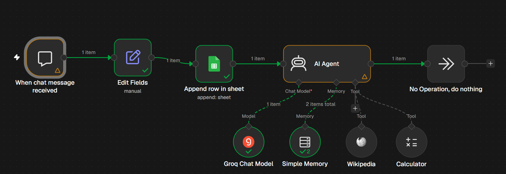
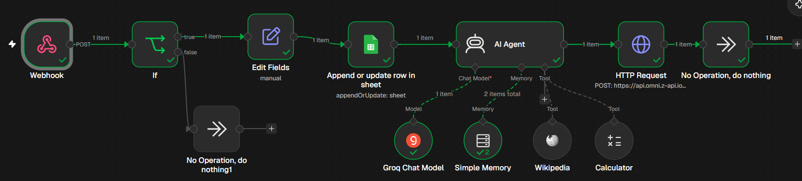

# Case 01 — Agente de IA com Google Sheets

  

Primeiro projeto desenvolvido durante meus estudos de automação com n8n.

**Ferramentas:** n8n Cloud, AI Agent, Groq e Google Sheets.

**O que pratiquei:**
- Criação de workflows.
- Configuração de agente de IA.
- Integração com Google Sheets.
- Uso de memória e ferramentas auxiliares.

O arquivo `workflow-sanitizado.json` contém a exportação sanitizada do fluxo.

---

# Case 02 — Agente de IA com WhatsApp

  

Segundo projeto desenvolvido durante meus estudos de automação com n8n, integrando um agente de IA ao WhatsApp.

**Ferramentas:** n8n Cloud, AI Agent, Groq, Google Sheets, Webhook e API da Z-API Omni.

**O que pratiquei:**
- Recebimento de mensagens do WhatsApp por meio de Webhook.
- Filtragem de eventos e identificação de mensagens individuais.
- Tratamento de dados com Edit Fields.
- Registro e atualização de contatos no Google Sheets.
- Configuração de agente de IA com memória e ferramentas auxiliares.
- Envio automático de respostas pelo WhatsApp usando requisição HTTP e API.

O arquivo `workflow-sanitizado-case2.json` contém a exportação sanitizada do fluxo. Para reutilizá-lo, é necessário configurar suas próprias credenciais, canal e planilha.
